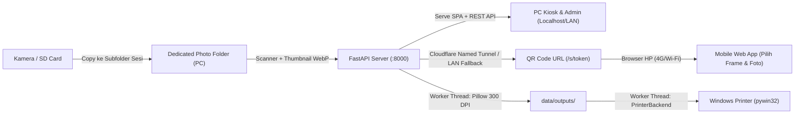

# Core Self-Photo Studio App
Status: berjalan
Tujuan: Membangun aplikasi pemilihan Frame dan Foto untuk self-photo studio (PC Kiosk + Mobile via QR Code) dengan Admin Dashboard manajemen frame/slot/folder, compositing 300 DPI, dan sistem printing Windows (Auto-Print / Manual Print Queue).

---

## Ringkasan Arsitektur & Ruang Lingkup



### Aturan & Batasan Operasional Utama
- **Mode Offline**: PC Kiosk dan HP di Wi-Fi studio tetap berfungsi penuh lewat `localhost` / IP LAN lokal saat internet atau tunnel mati; QR otomatis fallback ke IP LAN bila public URL tidak aktif.
- **Tunnel**: Direkomendasikan **Cloudflare Named Tunnel** (domain tetap agar URL tidak berubah). Jika menggunakan **Cloudflare Quick Tunnel**, batasannya adalah URL berganti setiap kali proses/PC restart sehingga QR sesi sebelumnya menjadi tidak valid.
- **Keamanan Admin & Tunnel**: Seluruh endpoint `/api/admin/*` dan kontrol antrean cetak hanya boleh diakses dari `localhost`/LAN dan menolak request yang membawa header proxy tunnel eksternal (`CF-Connecting-IP`, `True-Client-IP`, `X-Forwarded-For` publik). Endpoint Browse Folder bersifat `localhost`-only. Tidak ada PIN/secret hardcoded di dalam kode (PIN diatur saat first-run di localhost atau lewat environment variable).
- **Keamanan Token QR**: Menggunakan `secrets.token_urlsafe(32)`, memiliki `expires_at`, otomatis tidak valid saat sesi berstatus `completed`, dan dilindungi rate limiting per IP.
- **Multi-Perangkat**: Beberapa HP yang memindai QR sesi yang sama dapat menyusun pilihan frame/foto secara paralel di perangkat masing-masing (draft disimpan di client), dan setiap aksi **Cetak** membuat `print_job` independen (append-only). Perubahan status sesi (`completed`) mengikuti aturan **last-write-wins** dengan konfirmasi di Kiosk.
- **Pemakaian Ulang Subfolder**: Jika operator memilih subfolder yang sudah pernah dipakai sesi lain, Admin menampilkan peringatan eksplisit dan menyediakan opsi filter foto berdasarkan waktu registrasi sesi (`only_photos_after`) atau membuat subfolder baru.
- **Scope Slot Frame**: Slot foto hanya berbentuk **persegi panjang axis-aligned** (`xPct, yPct, wPct, hPct`). Rotasi slot dan bentuk non-persegi (lingkaran/polygon) berada di luar scope; efek bentuk dekoratif dicapai melalui area transparan pada overlay PNG frame.
- **Privasi & Retensi**: Form registrasi menampilkan persetujuan singkat pengumpulan Nama, WhatsApp, dan Email. Cache `data/thumbnails/` dan hasil `data/outputs/` otomatis dibersihkan setelah `N` hari (default 7 hari), dan Admin menyediakan tombol hapus data customer beserta job/output terkait (tanpa menyentuh foto asli kamera).

### Struktur Direktori Target

```text
F:\omah-ndog-project\
├── AGENTS.md                    # Panduan proyek & aturan kerja
├── catatan\                     # Catatan keputusan teknis & referensi desain
├── plan\                        # Plan implementasi bertahap
├── requirements.txt             # Dependensi Python backend
├── start_studio.bat             # Launcher 1-klik operator studio
├── backend\
│   ├── main.py                  # Entrypoint FastAPI, middleware keamanan, static SPA
│   ├── config.py                # Konfigurasi & path runtime
│   ├── database.py              # Koneksi SQLite (WAL mode) & migrasi skema
│   ├── schemas.py               # Model Pydantic (API, slots_json, selected_photos_json)
│   ├── security.py              # Guard localhost/LAN, anti-tunnel header, PIN hash & lockout, rate limiter
│   ├── routers\
│   │   ├── admin.py             # Auth PIN, settings, browse folder, customer history, cleanup
│   │   ├── frames.py            # CRUD kategori frame, upload PNG, simpan koordinat slot
│   │   ├── photos.py            # Subfolder list, scan foto, serve thumbnail & medium preview
│   │   ├── sessions.py          # Registrasi customer, QR code, validasi token sesi
│   │   └── prints.py            # Submit order cetak, status job, Print Queue & retry/cancel
│   ├── services\
│   │   ├── photo_scanner.py     # Path.resolve() guard, cek file stabil, Image.verify(), thumbnail WebP
│   │   ├── compositor.py        # Pillow 300 DPI compositing (EXIF, orientasi, safe margin)
│   │   ├── printer.py           # Interface PrinterBackend, WindowsSpoolerPrinter, MockPrinterBackend
│   │   ├── print_worker.py      # Background worker queue (non-blocking) untuk render & print
│   │   ├── qr_service.py        # Generate QR PNG dengan public URL / fallback LAN IP
│   │   └── cleanup_service.py   # Retensi otomatis thumbnails/ dan outputs/
│   └── tests\                   # Unit & integration tests (pytest)
├── frontend\
│   ├── package.json             # React, Vite, TypeScript (strict), lucide-react
│   ├── public\assets\           # Aset lokal hasil download dari Figma (tanpa URL temporer)
│   └── src\
│       ├── api\client.ts        # Typed API client
│       ├── pages\               # 7 layar sesuai Figma (Welcome, QR, Pilih Frame, Pilih Foto, Preview, Last Page, Admin)
│       └── components\          # FrameCompositePreview, FrameSlotEditor, PrintQueuePanel, AdminPinModal
└── data\                        # Runtime data (gitignored)
    ├── studio.db                # SQLite database (WAL mode)
    ├── frames\                  # Template frame PNG
    ├── thumbnails\              # Cache thumbnail WebP
    └── outputs\                 # Hasil render 300 DPI siap cetak
```

### Skema Database Ringkas (SQLite WAL)
- `settings`: `key`, `value` (`photo_root_dir`, `active_subfolder`, `folder_mode`, `public_base_url`, `auto_print_enabled`, `printer_name`, `retention_days`, `session_ttl_hours`, `admin_pin_hash`, `admin_pin_salt`).
- `frame_categories`: `id`, `name`, `price`, `width_mm`, `height_mm`, `orientation` (`portrait` | `landscape`), `safe_margin_mm`, `sort_order`.
- `frames`: `id`, `category_id`, `name`, `image_path`, `canvas_width`, `canvas_height`, `slots_json`, `created_at`.
- `customer_sessions`: `id`, `token` (hash/token dari `secrets.token_urlsafe(32)`), `name`, `whatsapp`, `email`, `consent_accepted`, `photo_subfolder`, `filter_after_created_at`, `status` (`active` | `completed`), `expires_at`, `created_at`.
- `print_jobs`: `id`, `session_id`, `frame_id`, `category_name`, `unit_price`, `copies`, `total_price`, `selected_photos_json`, `output_image_path`, `status` (`queued` | `printing` | `printed` | `failed` | `cancelled`), `error_message`, `created_at`, `updated_at`.

---

## Fase 1: Fondasi Backend, Database, & Auth
- Tujuan: Menyiapkan struktur proyek backend FastAPI, database SQLite dengan WAL mode, validasi Pydantic, mekanisme autentikasi Admin PIN (dengan lockout & proteksi tunnel), serta manajemen settings dasar dan sesi customer.
- Tugas:
  - [x] Buat `requirements.txt` (FastAPI, Uvicorn, Pydantic, Pillow, qrcode, python-multipart, pytest, httpx, pywin32 opsional Windows) dan catat alasan tiap dependency di `catatan\`.
  - [x] Implementasi `backend/config.py` dan `backend/database.py`: koneksi SQLite dengan `PRAGMA journal_mode=WAL`, `PRAGMA foreign_keys=ON`, `PRAGMA busy_timeout=5000`, serta inisialisasi tabel & seed kategori default (`4R`, `5R`, `Polaroid`, `News Paper`).
  - [x] Implementasi `backend/schemas.py`: seluruh request/response schema Pydantic termasuk validator ketat untuk `slots_json` (persentase `0..100`, persegi axis-aligned) dan `selected_photos_json` (nama file tanpa path separator, offset/zoom dalam batas aman).
  - [x] Implementasi `backend/security.py`:
    - Middleware/dependency guard `/api/admin/*` khusus `localhost`/LAN dan menolak request dengan header tunnel (`CF-Connecting-IP`, `True-Client-IP`, `X-Forwarded-For` non-LAN).
    - Guard `localhost`-only khusus endpoint Browse Folder.
    - Hashing PIN Admin (`pbkdf2_hmac` + salt acak, tanpa PIN hardcoded; dukung first-run setup PIN di localhost atau env `ADMIN_INITIAL_PIN`), penerbitan session token Admin (`secrets.token_urlsafe(32)`), dan lockout setelah 5 kali PIN salah (lockout 15 menit).
    - Rate limiter berbasis IP untuk endpoint publik customer (`/api/sessions/*`, `/api/photos/*`).
  - [x] Implementasi `backend/routers/admin.py` (bagian auth & settings: status setup PIN, login/logout, ubah PIN, get/update settings termasuk `public_base_url`, `retention_days`, `session_ttl_hours`, dan endpoint localhost-only native Browse Folder + validasi path manual eksis & readable).
  - [x] Implementasi `backend/routers/sessions.py` & `backend/services/qr_service.py`: registrasi customer (validasi `consent_accepted=true`), generate token `secrets.token_urlsafe(32)` dengan `expires_at`, invalidasi saat `completed`, dan generate gambar QR PNG dengan fallback IP LAN saat `public_base_url` kosong.
  - [x] Implementasi `backend/main.py` untuk menyatukan router dan health check `/api/health`.
- File terdampak: `requirements.txt`, `backend/main.py`, `backend/config.py`, `backend/database.py`, `backend/schemas.py`, `backend/security.py`, `backend/routers/admin.py`, `backend/routers/sessions.py`, `backend/services/qr_service.py`, `backend/tests/test_phase1_auth_sessions.py`
- Kriteria selesai:
  - Server FastAPI jalan bersih di `localhost:8000` dan tabel SQLite terbuat dalam mode `WAL`.
  - `/api/admin/*` menolak request dengan header `CF-Connecting-IP` (403), menolak tanpa token (401), dan melakukan lockout setelah 5 kali salah PIN (429).
  - Endpoint Browse Folder menolak request non-localhost (403); input path manual yang tidak ada atau tidak terbaca ditolak (400).
  - Token QR memiliki entropi tinggi (`secrets.token_urlsafe(32)`), gagal diakses setelah expired atau setelah sesi `completed` (403/410), dan terkena rate limit saat di-spam.
- Verifikasi: Jalankan `pytest backend/tests/test_phase1_auth_sessions.py` dan cek `PRAGMA journal_mode` mengembalikan `wal`.
- Dependensi & risiko: Tidak ada dependensi fase sebelumnya. Risiko: deteksi IP LAN pada PC dengan banyak virtual adapter (atasi dengan memilih IP outbound default via UDP socket tanpa kirim paket + fallback `127.0.0.1`).

---

## Fase 2: Admin Dashboard — Frame & Slot Editor
- Tujuan: Menyediakan API CRUD kategori & template frame PNG beserta UI Admin Dashboard (`Group 16`) lengkap dengan **Interactive Frame Slot Editor** (tambah slot persegi, drag, resize, lock, undo/redo, simpan dalam persen) serta pengaturan dedicated folder & subfolder sesi.
- Tugas:
  - [x] Implementasi `backend/routers/frames.py`:
    - CRUD kategori frame (`name`, `price`, `width_mm`, `height_mm`, `orientation`, `safe_margin_mm`).
    - Upload template frame PNG (validasi format gambar & ukuran maksimum, simpan ke `data/frames/`, baca dimensi asli lewat threadpool).
    - Update & validasi `slots_json` (persegi axis-aligned, `xPct, yPct, wPct, hPct`, `locked`) via Pydantic; hapus frame beserta file PNG terkait.
  - [x] Inisialisasi proyek `frontend/` (React + Vite + TypeScript strict, font `Poller One` & `Inter`, CSS design tokens sesuai Figma).
  - [x] Unduh aset latar Admin Dashboard dari Figma (`BG LP 1`) ke `frontend/public/assets/` menggunakan `curl -L` dan pastikan tidak ada URL Figma temporer di kode.
  - [x] Buat `frontend/src/api/client.ts` dan `frontend/src/components/AdminPinModal.tsx` (mendukung alur first-run setup PIN dan login PIN + pesan lockout).
  - [x] Buat `frontend/src/components/FrameSlotEditor.tsx`: kanvas overlay frame dengan toolbar `#FE4E12` persis ikon Figma (`PlusSquare`, `Lock`, `CornerDownLeft` undo, `CornerDownRight` redo, `Check` save), drag & resize slot persegi dalam koordinat persen, tombol hapus slot.
  - [x] Buat `frontend/src/pages/AdminDashboard.tsx` sesuai desain `Group 16`:
    - Bagian **Frame Setting**: tab kategori (`#FE4E12`, aktif `#0143A1`, tombol `+` tambah/edit kategori termasuk orientasi & safe margin), `Input Harga`, tombol `+` upload frame, grid frame, dan `FrameSlotEditor` di panel kanan.
    - Bagian **Photo File**: input bar `#FF8D28` + tombol Browse Folder (localhost) + Save + pemilih Subfolder Aktif (dengan peringatan jika subfolder pernah dipakai sesi lain & opsi buat subfolder baru / filter waktu registrasi).
    - Bagian **Pengaturan Tunnel & Sistem**: input `public_base_url` (dengan info perbedaan Named Tunnel vs Quick Tunnel & status IP LAN fallback).
- File terdampak: `backend/routers/frames.py`, `backend/tests/test_phase2_frames.py`, `frontend/package.json`, `frontend/tsconfig.json`, `frontend/index.html`, `frontend/public/assets/bg-admin.png`, `frontend/src/api/client.ts`, `frontend/src/components/AdminPinModal.tsx`, `frontend/src/components/FrameSlotEditor.tsx`, `frontend/src/pages/AdminDashboard.tsx`
- Kriteria selesai:
  - Admin dapat login PIN, menambah/mengubah kategori & harga, mengunggah frame PNG, mengatur beberapa slot persegi (drag/resize/lock/undo/redo), menyimpan ke SQLite, dan melihat posisi slot persis sama setelah reload halaman.
  - Koordinat slot yang tidak valid (`wPct <= 0` atau keluar batas `> 100`) ditolak oleh Pydantic (422).
  - Admin dapat mengatur dedicated folder & melihat daftar subfolder.
- Verifikasi: `pytest backend/tests/test_phase2_frames.py`, `npm run build` di `frontend/` (TypeScript strict tanpa error), dan uji manual drag/resize/undo/redo/save slot di browser.
- Dependensi & risiko: Bergantung pada Fase 1. Risiko: perbedaan rasio tampilan kanvas editor di browser vs dimensi asli gambar PNG (atasi dengan menghitung posisi relatif terhadap bounding box aktual elemen `` frame dan menyimpannya murni dalam persen `0..100`).

---

## Fase 3: Foto — Scanner Subfolder & Thumbnail Cache
- Tujuan: Membangun layanan pembacaan foto dari subfolder sesi yang aman terhadap path-traversal, tahan terhadap file yang belum selesai disalin dari kamera, serta menghasilkan thumbnail WebP ringan untuk HP.
- Tugas:
  - [x] Implementasi `backend/services/photo_scanner.py`:
    - Validasi ketat menggunakan `Path.resolve()` agar akses foto selalu berada di dalam `photo_root_dir / session.photo_subfolder` (tolak `..`, symlink keluar root, atau nama file berseparator).
    - Filter ekstensi gambar yang didukung (`.jpg`, `.jpeg`, `.png`, `.webp`).
    - Deteksi file belum selesai disalin: cek stabilitas `st_size` & `st_mtime` (dua pembacaan berjeda singkat) lalu validasi header/struktur gambar via `Image.verify()` di threadpool; file yang belum siap dilewati sementara tanpa error.
    - Dukungan filter waktu opsional (`mtime >= session.created_at`) jika subfolder digunakan ulang oleh lebih dari satu customer.
    - Generasi & caching thumbnail WebP (`max 480px`, EXIF auto-orient via `ImageOps.exif_transpose`) dan medium preview (`max 1200px`) di `data/thumbnails/` melalui threadpool agar tidak memblokir event loop.
  - [x] Implementasi `backend/routers/photos.py`:
    - Endpoint admin: list subfolder di dalam dedicated folder (beserta jumlah foto & penanda apakah subfolder sudah pernah dipakai sesi sebelumnya) + buat subfolder baru.
    - Endpoint customer (terproteksi token sesi valid + rate limit): list daftar foto sesi, ambil thumbnail WebP, dan ambil medium preview.
- File terdampak: `backend/services/photo_scanner.py`, `backend/routers/photos.py`, `backend/tests/test_phase3_photos.py`
- Kriteria selesai:
  - Upaya path-traversal (`../`, encoded `%2e%2e`, symlink keluar folder) ditolak (400/403).
  - File korup atau file yang sedang ditulis (incomplete bytes) tidak menyebabkan crash dan otomatis dilewati sampai valid.
  - Thumbnail WebP terbuat dengan orientasi EXIF benar dan ukuran ringan (<100 KB untuk foto DSLR standar).
- Verifikasi: `pytest backend/tests/test_phase3_photos.py` (termasuk test path-traversal, file korup/terpotong, orientasi EXIF, dan filter waktu registrasi).
- Dependensi & risiko: Bergantung pada Fase 1. Risiko: kamera menyalin puluhan file sekaligus (atasi dengan membatasi konkurensi pembuatan thumbnail lewat semaphore di threadpool agar CPU/disk PC studio tidak tersendat).

---

## Fase 4: Alur Customer (Kiosk & Mobile + Aset Figma)
- Tujuan: Mengimplementasikan seluruh 6 layar alur customer sesuai desain Figma (responsif untuk PC Kiosk 1920×1080 dan layar HP ~390×844) dengan seluruh aset Figma tersimpan lokal.
- Tugas:
  - [x] Unduh seluruh aset Figma yang tersisa (`BG Page 1`, `BG Sisa Page`, foto hero Welcome, dan SVG/aset UI yang digunakan) ke `frontend/public/assets/` dengan `curl -L`. Verifikasi tidak ada referensi `figma.com/api/mcp/asset` di seluruh codebase.
  - [x] Buat `frontend/src/pages/WelcomePage.tsx` (`Group 14`): split screen hero photo + form `Name`, `Whatsapp`, `Email`, persetujuan privasi singkat, tombol `NEXT`, dan ikon Settings (Gear) membuka `AdminPinModal`.
  - [x] Buat `frontend/src/pages/QrPage.tsx` (`Group 15`): tampilkan QR Code sesi, teks *"Scan QR buat memilih Frame, dan Foto dari HP kalian masing masing"*, indikator jumlah foto terdeteksi & mode koneksi (Tunnel/LAN), tombol `NEXT` (lanjut di Kiosk) dan `ArrowLeft`.
  - [x] Buat `frontend/src/components/FrameCompositePreview.tsx`: komponen preview live yang merender foto terpilih di bawah overlay template frame PNG menggunakan koordinat persen (`xPct, yPct, wPct, hPct`), mendukung pemilihan slot aktif dan penyesuaian posisi crop (`offsetX`, `offsetY`, `zoom`).
  - [x] Buat `frontend/src/pages/SelectFramePage.tsx` (`Pilih Frame`): tab kategori (`#FE4E12`, aktif `#FFCC00`), tampilan `Harga`, grid frame panel pink `#FFADD1`, preview frame, dan tombol `Pilih Foto` (responsif Desktop & Mobile).
  - [x] Buat `frontend/src/pages/SelectPhotoPage.tsx` (`Pilih Foto`): polling otomatis foto baru dari subfolder sesi, grid thumbnail WebP, live `FrameCompositePreview` interaktif, indikator progres slot, dan tombol `Cetak`.
  - [x] Buat `frontend/src/pages/LastPreviewPage.tsx` (`Preview`): `Last Preview` besar, stepper jumlah cetak `- [ 01 ] +`, teks keterangan (typo *"umlah"* diperbaiki menjadi *"Jumlah"*), ringkasan total harga, dan tombol `Cetak`.
  - [x] Buat `frontend/src/pages/PrintingPage.tsx` (`Last Page`): status proses cetak real-time, tombol `Cetak lagi` (kembali ke `Pilih Frame` dalam sesi yang sama), dan tombol `Selesai` (akhiri sesi dengan konfirmasi).
  - [x] Konfigurasi routing SPA (`/`, `/admin`, `/s/:token/frame`, `/s/:token/photo`, `/s/:token/preview`, `/s/:token/printing`) dan mount build statis React di `backend/main.py` agar berjalan dalam satu origin (`:8000`).
- File terdampak: `frontend/public/assets/*`, `frontend/src/App.tsx`, `frontend/src/components/FrameCompositePreview.tsx`, `frontend/src/pages/WelcomePage.tsx`, `frontend/src/pages/QrPage.tsx`, `frontend/src/pages/SelectFramePage.tsx`, `frontend/src/pages/SelectPhotoPage.tsx`, `frontend/src/pages/LastPreviewPage.tsx`, `frontend/src/pages/PrintingPage.tsx`, `backend/main.py`
- Kriteria selesai:
  - Semua 6 layar customer + Admin Dashboard tampil sesuai warna, font (`Poller One` + shadow `#FE4E12`, `Inter`), dan tata letak Figma tanpa aset broken atau URL Figma temporer.
  - Alur penuh dapat diselesaikan baik dari Kiosk (`localhost:8000`) maupun viewport Mobile via URL QR (`/s/:token`).
  - Dua perangkat membuka URL QR yang sama dapat memilih frame/foto masing-masing tanpa saling menimpa draft.
- Verifikasi: `npm run build` di `frontend/`, audit grep memastikan nol URL `figma.com/api/mcp/asset`, serta uji visual & klik end-to-end di browser pada viewport Desktop (1920×1080) dan Mobile (390×844).
- Dependensi & risiko: Bergantung pada Fase 1, 2, dan 3. Risiko: layout Figma dibuat untuk 1920×1080 sehingga panel 2-kolom bisa sempit di HP (atasi dengan layout responsif bertumpuk vertikal di mobile dengan sticky preview ringkas agar tetap nyaman disentuh).

---

## Fase 5: Compositing 300 DPI, Printing, & Print Queue
- Tujuan: Mengimplementasikan rendering compositing 300 DPI non-blocking, abstraksi printer Windows (`PrinterBackend`) yang dapat di-mock, worker antrean cetak dengan penanganan error/retry/cancel, serta panel Print Queue di Admin Dashboard.
- Tugas:
  - [x] Implementasi `backend/services/compositor.py`:
    - Hitung dimensi kanvas 300 DPI dari `width_mm`, `height_mm`, dan `orientation` (`portrait`/`landscape`), serta dukungan `safe_margin_mm`.
    - Terapkan `ImageOps.exif_transpose`, center-cover crop + offset/zoom user ke tiap slot persegi (`xPct, yPct, wPct, hPct`), lalu alpha-composite overlay frame PNG di atasnya.
    - Simpan hasil akhir beresolusi 300 DPI ke `data/outputs/<session_id>/<job_id>.jpg` (atau PNG/JPEG high quality dengan metadata `dpi=(300, 300)`).
  - [x] Implementasi `backend/services/printer.py`:
    - Definisikan interface `PrinterBackend` (`list_printers`, `get_printer_status`, `print_image`).
    - Implementasi `WindowsSpoolerPrinter` menggunakan `pywin32` (`win32print` + `PIL.ImageWin`) dengan pengecekan status printer (deteksi offline, paper out, error spooler) dan pengaturan orientasi/jumlah copy.
    - Implementasi `MockPrinterBackend` untuk unit test & pengembangan tanpa printer fisik (bisa mensimulasikan sukses, printer offline, dan kertas habis).
  - [x] Implementasi `backend/services/print_worker.py`: worker threadpool / antrean latar belakang agar compositing dan proses kirim ke printer tidak pernah memblokir event loop FastAPI; otomatis meneruskan ke printer bila `auto_print_enabled=true` atau menahan di status `queued` untuk mode Manual Queue.
  - [x] Implementasi `backend/routers/prints.py`:
    - Endpoint customer (token sesi valid): submit print job (validasi Pydantic `selected_photos_json` & `copies >= 1`), cek status job untuk layar `PrintingPage`.
    - Endpoint admin (terautentikasi + guard LAN/localhost): daftar Print Queue, trigger **Print Sekarang**, **Retry** job `failed`, **Cancel** job `queued`/`failed`, download file 300 DPI, serta cek daftar & status printer Windows.
  - [x] Buat `frontend/src/components/PrintQueuePanel.tsx` dan integrasikan ke `AdminDashboard.tsx`: pilih printer, toggle Auto-Print vs Manual Queue, daftar job real-time dengan thumbnail output, status error printer jelas, serta tombol Print, Retry, Cancel, dan Download.
- File terdampak: `backend/services/compositor.py`, `backend/services/printer.py`, `backend/services/print_worker.py`, `backend/routers/prints.py`, `backend/tests/test_phase5_printing.py`, `frontend/src/components/PrintQueuePanel.tsx`, `frontend/src/pages/AdminDashboard.tsx`
- Kriteria selesai:
  - Submit cetak menghasilkan file 300 DPI akurat (dimensi piksel sesuai `width_mm × height_mm`, orientasi, dan `safe_margin_mm`) tanpa membuat request API lain melambat.
  - Mode Auto-Print langsung memanggil `PrinterBackend.print_image`; mode Manual Queue menahan job sampai operator menekan Print di Admin.
  - Simulasi printer offline / kertas habis mengubah status job menjadi `failed` dengan pesan jelas, dan tombol Retry / Cancel bekerja dengan benar.
- Verifikasi: `pytest backend/tests/test_phase5_printing.py` (memakai `MockPrinterBackend` untuk skenario sukses, offline, kertas habis, retry, cancel, dan verifikasi piksel hasil compositing 300 DPI) + uji cetak manual ke `Microsoft Print to PDF` di Windows.
- Dependensi & risiko: Bergantung pada Fase 2, 3, dan 4. Risiko: perbedaan margin fisik antar model printer foto thermal/inkjet (dimitigasi dengan pengaturan `safe_margin_mm` per kategori di Admin).

---

## Fase 6: Hardening, Cleanup, & Pengujian Menyeluruh
- Tujuan: Melengkapi fitur manajemen privasi & retensi file, histori customer + Export CSV, launcher operator Windows 1-klik, serta pengujian menyeluruh end-to-end (online tunnel, offline LAN, keamanan, dan UI).
- Tugas:
  - [x] Implementasi `backend/services/cleanup_service.py`: pembersihan otomatis file `data/thumbnails/` dan `data/outputs/` lebih tua dari `retention_days` saat startup dan secara periodik di background, ditambah endpoint pemicu manual di Admin.
  - [x] Lengkapi `backend/routers/admin.py` & UI `AdminDashboard.tsx`: tabel histori customer (`Name`, `Whatsapp`, `Email`, jumlah job, total harga), tombol **Export CSV**, dan tombol **Hapus Data Customer** (menghapus record & file output terkait tanpa menghapus foto asli kamera).
  - [x] Buat `start_studio.bat`: launcher 1-klik untuk menjalankan server FastAPI (otomatis mendeteksi apakah build frontend tersedia) dan membuka Kiosk di browser, beserta instruksi singkat konfigurasi Cloudflare Named Tunnel (dan catatan batasan Quick Tunnel).
  - [x] Audit keamanan & kualitas menyeluruh:
    - Pastikan tidak ada secret/kredensial hardcoded di kode.
    - Pastikan tidak ada blocking call (Pillow / `win32print`) di handler `async def`.
    - Pastikan `/api/admin/*` dan `/api/prints/queue*` terblokir dari header tunnel.
    - Pastikan `.gitignore` mengecualikan `data/` dan file sensitif lokal.
  - [x] Uji otomatis menyeluruh (`pytest` Fase 1–6 & Playwright E2E Fase 4–6: retensi & cleanup manual/setting korup, histori customer `printed`-only & paginasi >500, export CSV lengkap + sanitasi formula, hapus data customer + guard `409` & keamanan foto kamera, auth `401`, tunnel `403`, kolaborasi desktop+mobile, mode LAN/public URL, serta retry/cancel cetak gagal).
  - [ ] Uji manual operasional di PC studio (`start_studio.bat`, mode offline LAN HP nyata, public URL Cloudflare Named Tunnel, dan cetak fisik / `Microsoft Print to PDF`).
- File terdampak: `backend/services/cleanup_service.py`, `backend/routers/admin.py`, `backend/tests/test_phase6_hardening_cleanup.py`, `frontend/src/pages/AdminDashboard.tsx`, `start_studio.bat`, `.gitignore`
- Kriteria selesai:
  - Seluruh suite `pytest` dan build `frontend` (`tsc --noEmit && npm run build`) lulus 100%.
  - Retensi menghapus file expired dan menyisakan file baru; tombol hapus customer membersihkan DB & output tanpa menyentuh foto asli di dedicated folder.
  - Aplikasi dapat dijalankan dengan `start_studio.bat` dan berfungsi penuh baik saat offline (LAN/localhost) maupun via Cloudflare Tunnel.
- Verifikasi: Jalankan `pytest`, `npm run build`, uji manual `start_studio.bat`, verifikasi mode offline (matikan internet / kosongkan `public_base_url`), dan verifikasi blokir header `CF-Connecting-IP` ke `/api/admin/*`.
- Dependensi & risiko: Bergantung pada Fase 1–5. Risiko: antarmuka Windows Firewall memblokir port `8000` untuk akses HP via LAN (atasi dengan catatan setup izin Firewall LAN lokal di dokumentasi operator).
